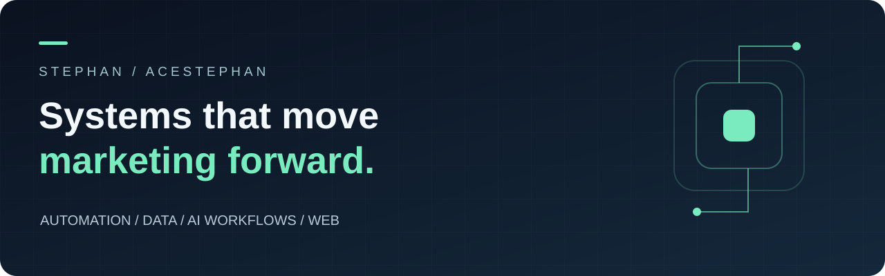
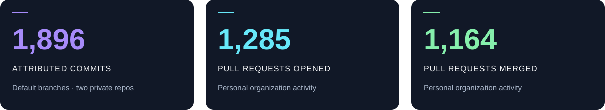

<p align="center"></p>

<p align="center">
  <a href="https://ace.inc"></a>
  <a href="#what-i-build"></a>
  <a href="SELECTED-WORK.md"></a>
</p>

<h1 align="center">Hey, I’m Stephan.</h1>
<p align="center"><strong>I turn marketing operations into software people can actually use.</strong></p>

I work on automation and product engineering at **[Ace](https://ace.inc)**, a creator marketing and growth agency. My work spans the systems that get content out, the reporting that makes performance understandable, and the web and mobile experiences that connect creators with their team.

I work across **Python, TypeScript, React, and Swift**, with **Codex and Claude Code** as part of my development workflow. That includes building features, investigating broken integrations, recovering missing data, refining interfaces, and verifying what actually shipped.

```yaml
focus:       creator growth, marketing execution, and dependable software
build:       web apps • iOS experiences • integrations • cloud automation
care_about:  accurate data • usable interfaces • maintainable workflows
approach:    understand → build → test → verify
```

## What I build

| | Area | My work |
| :---: | :--- | :--- |
| 🌐 | **Creator & team portals** | Dashboards, shared team tools, account views, calendars, and consistent data across different roles. |
| 📱 | **iOS experiences** | Creator app improvements, interactive charts, navigation, notifications, and release preparation. |
| 📈 | **Marketing intelligence** | Social reporting, audience trends, posting evidence, freshness checks, and recovery when sources are incomplete. |
| ⚙️ | **Cloud automation** | Scheduled reporting, background workers, source integrations, and migrations away from desktop-dependent jobs. |
| 🧠 | **AI development workflows** | Reusable skills, repo-aware assistants, verification loops, and practical workflows for Codex and Claude Code. |
| 🎨 | **Web & interface design** | Landing pages, responsive layouts, brand details, chart interactions, and clearer loading and error states. |
| 🔔 | **Notifications & integrations** | Event-driven updates, messaging failure handling, delivery evidence, and provider integrations. |
| 🛠️ | **Reliability & developer tooling** | Data contracts, cache correctness, performance fixes, release checks, and repeatable device setup workflows. |

**[Explore selected work →](SELECTED-WORK.md)**

## Real work, mostly in private repositories

<p align="center"></p>

These are a **GitHub API snapshot from October 27, 2026**, not live counters. Commit totals cover two private repositories; PR totals cover my organization activity. Commits and PRs are different measures and are not added together. The public contribution graph may show less because of visibility settings and GitHub’s counting rules.

## Tools I work with

<p align="center"></p>

**Development:** Python · TypeScript · JavaScript · React · Swift · HTML/CSS<br />
**Data & infrastructure:** APIs · SQLite · Firestore · Firebase · Google Cloud · GitHub Actions<br />
**AI-assisted engineering:** Codex · Claude Code · reusable skills · verification workflows

## How I work

- **Follow the source.** When a dashboard is wrong, trace the data and repair the cause.
- **Build for the person using it.** A correct backend still needs a clear, responsive interface.
- **Treat missing data honestly.** Unknown, incomplete, and zero should mean different things.
- **Verify the last step.** A passing test, merged PR, and working release are separate milestones.
- **Leave a system behind.** Make the next run, diagnosis, or handoff easier than the last one.

---

<p align="center"><strong>Marketing is the purpose. Software makes the work repeatable.</strong><br /><sub>Public summaries only. Client identities, business metrics, credentials, private source code, and internal architecture stay private.</sub></p>
